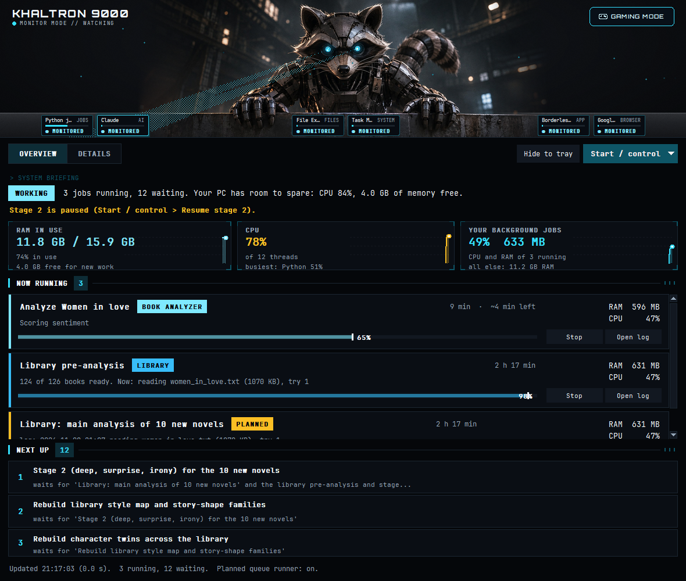

# Khaltron 9000

**Khaltron 9000 is a free Windows desktop app that keeps an eye on everything running in the background of your
PC, and hands the PC back to you when you want to play.**

If you run long jobs on your computer (data analysis, AI model runs, Python scripts, batch work that takes hours),
it's easy to lose track of what's still going, what's next, and how much of your PC it's eating. Khaltron puts all of
that in one dark window, watched over by a mechanical raccoon with glowing eyes. And when you sit down to play a
game, one click (or no click at all, with auto mode) freezes the background work so the game gets the CPU and memory,
then lets everything carry on where it left off when you're done.



## Features at a glance

**See what's going on**
- **Running jobs**: what each one is doing, its progress, its RAM and CPU, and **how long it has left** ("done ~3:05 am").
- **What's next**: the queue of waiting jobs, and what each one is waiting for.
- **What finished or failed**, with its log one click away.
- **Your PC's health**: RAM and CPU like Task Manager shows them, and how much of that your jobs take.
- **Every program on your PC**, grouped by app, with its share of the CPU and RAM.
- **Startup apps**: what starts when you log in and what it costs you.

**Take control**
- **Pause, resume, close or end** any of your programs (Windows' own parts are never offered).
- **Turn startup apps on or off**, the same way Task Manager does.
- **Stop, reorder or remove jobs**, and **queue new ones** with `jobq`, so heavy jobs run one at a time instead of
  fighting over memory.
- Every action asks "Are you sure?" first, and important programs are protected from being stopped.

**Gaming mode**
- **One click** (or Ctrl+Alt+G) freezes your background jobs, heavy Python scripts and safe background apps (cloud
  sync, widgets...), sets Windows to Best performance, and puts it all back when you're done.
- **Auto gaming mode**: switches itself on when a game starts and off when it closes (with its own on/off switch).
- A little show in the top bar: the raccoon's eyes turn red and it locks onto each app it pauses.

**Development mode**
- **One click** on the header's DEV MODE button (or Ctrl+Alt+D) puts your work first: Claude and everything it
  runs, your terminal, VS Code and Stable Diffusion get high priority; background jobs are frozen; other apps keep
  running, lowered. The raccoon turns yellow and a short run of digital chirps plays.

**Stays out of your way**
- Lives in the tray by the clock and can start with Windows.
- Windows notifications when a job starts, finishes or fails, or memory runs low.
- Light: one quick look at all processes every 2 seconds; the window uses about 1% of the CPU.

## Why I made it

*By Khaldoun Alnaierat.* I usually have something going on in the background: big analyses and Python jobs, mostly
built with Claude's help, that can run for hours. But when I sit down to play a game, I'd like my PC back. So I made
Khaltron. It shows me what's running, pauses it all with one click, and lets everything carry on where it left off
once I'm done. It's just a small side project, free and open source (MIT). If it's useful to you too, feel free to
use it, change it, and have fun with it. (This is also the **About** tab in the app.)

## Features in detail

- **Two views.** *Overview* (the default) is the whole picture at a glance: a one-sentence briefing with a status
  chip (CALM, WORKING, BUSY, LOW MEMORY, GAMING), the RAM / CPU / jobs cards, the running jobs, the next three
  jobs, and the five programs using the most CPU. *Details* has every table: the full queue with its buttons,
  every program on the PC, finished jobs, scheduled tasks, Python processes and problems.
- **HUD cards** for RAM, CPU and your jobs, each with a live graph of the last 3 minutes; running jobs as cards with
  glowing progress bars, their RAM and CPU, and their own buttons.
- **Programs on this PC**: everything running, grouped by program (Chrome's 30 processes are one row). It reads every
  process in one Windows call (as Task Manager does), so it costs a few milliseconds. What no program owns (drivers,
  interrupts, kernel and cache memory) gets its own row, so the totals add up. Select one of *your* programs to
  **Pause** it (its windows freeze, nothing is lost), **Resume** it, **Close** it (like clicking its X) or **End** it
  now. Windows' own parts, services, Claude and its terminal, antivirus and the graphics driver are never offered,
  and the Note column says why.
- **Startup apps**: everything that starts when you log in, whether it's on, and the RAM it uses right now, with a
  switch to turn each one off or on for the next login. It uses the same on/off flags as Task Manager's Startup apps
  (nothing is deleted); entries set for every user ask for administrator permission.
- **Time left**: running jobs show roughly how long they have left and when they should be done ("~9 h 10 min left,
  done ~3:05 am"), from how fast they have gone so far.
- **Auto gaming mode** (the *Auto gaming mode* checkbox, or the tray menu): when a game starts, gaming mode turns
  itself on; when the game closes, off again. Games are recognised by their folder (Steam, Epic, Xbox, GOG, Riot,
  EA, Ubisoft...) or by filling the screen for 8 seconds (never a browser, video player or slide show). It only
  switches off what it switched on, and if you turn gaming mode off mid-game it leaves that game alone. Settings:
  `games` (extra game programs to recognise) and `not_games` (ones to ignore).
- **Live view**, refreshed every 2 seconds. It only *reads* status files and process info, so it never slows a job down.
- **Planned queue**: `jobq add --name "..." --after previous -- python my_script.py`. A small runner process starts the
  jobs in order and keeps going when the window is closed.
- **Full control**: stop a job (and everything it started), reorder or remove waiting jobs, run one next, pause the
  queue. Every action asks "Are you sure?" first.
- **Protected processes**: things that must never be stopped (by default: a voice server, a website, Khaltron itself)
  have no Stop button, and are checked again right before any stop.
- **Notifications**: a Windows pop-up when a job starts, finishes or fails, and when free memory runs low.
- **A top bar that watches**: a slim bar (about 110 px tall) with a mechanical raccoon in the middle and your
  six busiest apps as cards on either side; in monitor mode (cyan) it looks from card to card. Click **GAMING MODE** and it plays the design's
  sequence once: red, it pushes in and glares at every card (TERMINATE?, WARNED), its beams flood each
  side (PAUSED), then locks still. At that moment the jobs are really frozen. Cards it doesn't pause
  (your browser...) honestly say SPARED. The design package it follows is in `design/khaltron-header/`.
- **Gaming mode**: one click on the header's GAMING MODE button (or Ctrl+Alt+G) freezes every background job, any other
  heavy Python script of yours and safe background apps (cloud sync, Widgets, Phone Link...) so a game gets the
  CPU and memory,
  and puts everything back when you switch it off. A pop-up says what was frozen and how much memory it freed.
- **Light on your PC**: one Windows call per refresh reads every process (~55 ms), and the animations slow down
  when another window has the focus and stop in the tray. The window itself uses about 1% of the CPU.
- **Tray icon**: closing the window hides it next to the clock. It can start with Windows.

## Requirements

- Windows 10 or 11
- Python 3.11 or newer (with tkinter, which the standard Windows installer includes)

## Install

```powershell
git clone https://github.com/KhaldounN/khaltron.git
cd khaltron
powershell -ExecutionPolicy Bypass -File install.ps1
```

`install.ps1` checks for Python 3.11+ (and tells you where to get it if it's missing), makes a Python environment
(`.venv`) with the packages in `requirements.txt`, and adds:
- a desktop shortcut **Khaltron 9000** (hotkey **Ctrl+Alt+J**),
- a desktop shortcut **Khaltron Gaming Mode** (hotkey **Ctrl+Alt+G**, switches gaming mode on and off),
- a task that starts Khaltron in the tray when you log in (your user only).

Add `-NoStartup` to skip the logon task, or `-NoShortcuts` to skip the shortcuts. Prefer to do it by hand?

```powershell
python -m venv .venv
.venv\Scripts\python.exe -m pip install -r requirements.txt
.venv\Scripts\pythonw.exe monitor.pyw
```

Nothing else is changed on your PC: the fonts are loaded only while Khaltron runs, and the only registry entry is
Khaltron's name and icon for its notifications (your user only).

## Queue jobs with `jobq`

```powershell
# run a script now (or as soon as the queue is free)
.\jobq.ps1 add --name "Train the model" --cwd C:\work\project -- .venv\Scripts\python.exe -u train.py

# run another one after it
.\jobq.ps1 add --name "Evaluate" --after previous -- .venv\Scripts\python.exe -u evaluate.py

.\jobq.ps1 list        # what is queued, running and done
.\jobq.ps1 pause       # no new job starts (running ones go on);  .\jobq.ps1 resume
```

- `--after` can be `previous` (the last job in the queue), a job id, or `pid:<number>` (wait for a process to end),
  and you can give it more than once.
- The command starts at the first word that isn't an option, so the `--` is optional (PowerShell drops it anyway
  when it runs `jobq.ps1`).
- Each job's output goes to `state\logs\<id>.log`, and the window shows its last line as "Doing now".
- A `.ps1` command is run with PowerShell.

A script that runs on its own can also just **report in**, so it shows in the window:

```powershell
$job = & .\jobq.ps1 begin --name "Nightly export"      # it shows as running (its process id is filled in)
# ... the script's work ...
& .\jobq.ps1 finish $job --exit $LASTEXITCODE
```

## Gaming mode

`gaming.ps1 on | off | toggle | status`, or Ctrl+Alt+G, the tray menu, or *Start / control* in the window.
**On** pauses the planned queue, freezes (suspends) every running background job and asks Windows to move its memory
aside, also freezes any other heavy Python script of yours and background apps that are safe to pause (cloud sync such as
OneDrive, Dropbox and Google Drive, Adobe's sync, Windows Widgets, Phone Link), plays a short sound, and sets the
Windows power mode to Best performance. What it changed is
written to `state\gaming.json` (the file existing *is* the switch; other tools can check it, and the
`gaming_flag` setting moves it). **Off** undoes exactly that, and frozen jobs
carry on where they were. While it is on, a job that starts anyway is frozen too. Protected processes are never
frozen. Every switch is logged in `state\gaming.log`.

## Development mode

`devmode.ps1 on | off | toggle | status`, or Ctrl+Alt+D, the header's **DEV MODE** button (left of GAMING MODE), the
tray menu, or *Start / control*. While it is on the header turns yellow (raccoon, eyes, beams, cards) and reads
*DEV MODE // YOUR WORK FIRST*; switching on plays `assets\khaltron-dev-mode.wav` (made by
`tools\make_dev_sound.py`, settings `dev_sound` and `dev_sound_volume`).
**On** pauses the planned queue and freezes the same background jobs and apps as gaming mode, but never the Book
Analyzer website or the read-aloud voice. It gives **above normal** priority to your work: every `claude.exe` and everything it
started (node, python, shells, dev servers, its test browsers), Windows Terminal, VS Code, git, and anything run from a
Stable Diffusion folder (ComfyUI) with what it starts. Every other program **with a window** (browsers, chat...) is
lowered to *below normal*: it keeps working but always gives way; nothing with a window is frozen, so nothing looks
crashed. Browsers are never lowered (artifacts, docs and test pages open there), and the app in front (the one you
are typing in) is never lowered either: it goes back to normal while you use it. Windows' power mode goes to Best performance. A planned job is background work even when Claude queued it.
While it is on, every 15 s (`mode_check_seconds`) it freezes new jobs, boosts new main programs and lowers newly
opened ones, using the window's own process list (no second scan). Only the main programs are boosted (Claude,
terminal, editor, ComfyUI); the short commands Claude runs are never frozen but left at normal.
**Off** resumes the frozen jobs and sets back every priority it changed (unless you changed one yourself meanwhile).
The switch file is `state\dev-mode.json` (setting `dev_flag`); every switch is logged in `state\devmode.log`.
Gaming mode and development mode never run together: switching one on switches the other off first, and auto gaming
mode waits while development mode is on.

Settings: `dev_keep` (more program names that count as your work, e.g. `["cursor.exe"]`), `dev_keep_folders`
(folders whose programs are your work; default Stable Diffusion / ComfyUI), `dev_boost` (`"high"` or
`"above_normal"`, the default; "high" let a busy ComfyUI crowd out typing).

## The keyboard and mouse always stay quick

Some programs watch every key press (a "low-level hook"); frozen, they make Windows wait ~300 ms on every key. So the
first time Khaltron freezes or pauses a program (gaming mode, development mode, the Programs tab's Pause), it times
one invisible F24 tap and a zero-distance mouse move; if that is slow, the program is woken at once and never frozen
again. The answers are kept in `state\input_hooks.json` (`hooks` / `safe`; delete the file to check everything
again). Photoshop Express's helper (`PSExpressBroker.exe`) is known: freezing it made every key tap take 614 ms
instead of 1 ms. Add others with the setting `input_hooks`.

## Make it watch your own jobs

Out of the box Khaltron shows every program on your PC, your Python processes, the planned queue (`jobq`), scheduled
tasks and the PC's health, and gaming mode freezes your heavy Python scripts. Two ways to show your own jobs too:

- **Queue them with `jobq`** (above): no code. They show as running / waiting / done, with their log.
- **Add a reader** for jobs that already write a status file or log: a small file in `monitor\sources\` that returns
  `Job` rows (see `monitor\model.py`), called from `monitor\collect.py`. A reader only *reads*, so the window stays
  quick. `book_main.py`, `book_stage2.py` and `book_library.py` are examples: they read the author's book-analysis
  project and switch themselves off when that project isn't there.

### Settings

Put a `config.json` next to `monitor.pyw` (it's yours: it isn't in the repository). Any key of `DEFAULTS` in
`monitor\config.py` can be changed, for example:

```json
{
  "scheduled_tasks": ["Khaltron 9000", "My nightly backup"],
  "known_processes": [["train.py", "Model training", false], ["my_server.py", "My server", true]],
  "low_memory_mb": 2000,
  "gaming_also_freeze": {"OneDrive.exe": "OneDrive sync", "Dropbox.exe": "Dropbox sync"},
  "gaming_python_mb": 300,
  "gaming_sound_volume": 0.5
}
```

- `known_processes`: give your own processes a name in the window; `true` = protected (never stopped or frozen).
- `gaming_also_freeze`: background apps that are safe to freeze while you play (never your game, launcher, overlay,
  browser or chat). Yours are *added* to the built-in list; `"WidgetBoard.exe": null` takes one off. Apps that run
  as administrator can't be frozen.
- `gaming_sound`: `false` for a silent gaming mode.

## How it is built

| File | What it does |
|---|---|
| `monitor.pyw` | starts the window and the tray icon; a second launch just shows the first window |
| `monitor\ui.py` | the window (tkinter): tables, buttons, confirmations |
| `monitor\hunter.py` | the header, built to `design/khaltron-header/` (its README is the spec): the raccoon, its eyes and beams, the cards, the gaming-mode sequence |
| `monitor\about.py` | the About tab: who made it and why |
| `monitor\hud.py` | the stat cards with live graphs, the job cards, the overview parts |
| `monitor\theme.py` | every colour and font, the logo, the dark title bar |
| `monitor\collect.py` | one refresh: asks every reader and adds up what the jobs use |
| `monitor\sources\` | the readers (jobs, processes, every program on the PC, PC health, scheduled tasks) |
| `monitor\planned.py`, `monitor\runner.py`, `jobq.py` | the planned queue, the process that runs it, and its command line |
| `monitor\actions.py`, `monitor\protect.py` | what the buttons do, and the never-stop list |
| `monitor\alerts.py`, `monitor\tray.py` | notifications, history, the tray icon |
| `monitor\gaming.py`, `gaming.ps1` | gaming mode |
| `monitor\devmode.py`, `devmode.ps1` | development mode |
| `monitor\inputguard.py` | never freeze a program that watches the keyboard or mouse |

Run the tests with `.venv\Scripts\python.exe -m pytest`.

## License

[MIT](LICENSE): free to use, copy, change and share.

The bundled fonts are under the SIL Open Font License: Orbitron (The Orbitron Project Authors) and
JetBrains Mono (The JetBrains Mono Project Authors); their licences are in `assets/fonts/`. They are
loaded privately when Khaltron starts; nothing is installed in Windows.
